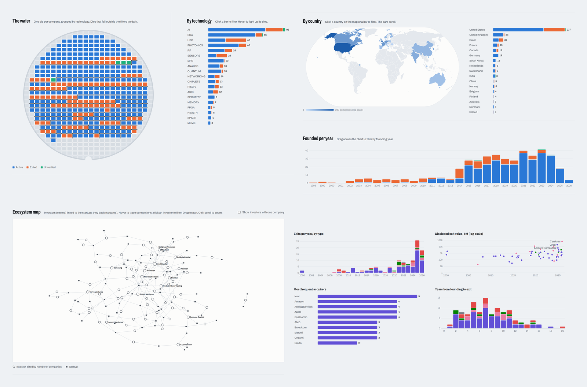

# Database of Awesome Semiconductor Startups

[](https://doi.org/10.5281/zenodo.20466138)

[](https://aolofsson.github.io/awesome-semiconductor-startups/dashboard/)

Search, filter and chart the whole database, including exits, in the
[interactive dashboard](https://aolofsson.github.io/awesome-semiconductor-startups/dashboard/).
It reads the CSV files in this repository, so it always matches the tables below.

## Citation:

If you use this repository in research, articles, presentations, or market analyses, please cite:

> Andreas Olofsson. *Database of Awesome Awesome Semiconductor Startups*.
> GitHub repository.
> https://github.com/aolofsson/awesome-semiconductor-startups

BibTeX:

```bibtex
@misc{olofsson_awesome_semiconductor_startups,
  author = {Andreas Olofsson},
  title = {Database of Awesome Semiconductor Startups},
  year = {2026},
  howpublished = {\url{https://github.com/aolofsson/awesome-semiconductor-startups}}
}
```

## Adding a company:

1. Create a branch
2. Add entry to './startups.csv'
3. Run '$ python ./update.py'
4. Run '$ python ./check.py' and fix any errors it reports
5. Submit a Pull Request

## Submission Guidelines:

* Startup requirements
	* startup (ie not steady state)
	* semi company (ie not application software)
	* product company (ie. not services)
* Alphabetical listing
* Short single sentence description
* No Performance claims in description!
* All entries must be confirmed with public link
* Max 80 char display width
* Categorize the startup based on technology table below
* Use standard two letter country codes
* Do NOT edit the README directly, it's auto-generated

## Disclaimer:

This databse is volunteer work and best effort. We do not guarantee correctness.
If you see a problem, submit an issue or PR.

DATA IS PROVIDED "AS IS", WITHOUT WARRANTY OF ANY KIND, EXPRESS OR IMPLIED, INCLUDING BUT
NOT LIMITED TO THE WARRANTIES OF MERCHANTABILITY, FITNESS FOR A PARTICULAR PURPOSE AND NONINFRINGEMENT.
IN NO EVENT SHALL THE AUTHORS OR COPYRIGHT HOLDERS BE LIABLE FOR ANY CLAIM, DAMAGES OR OTHER
LIABILITY, WHETHER IN AN ACTION OF CONTRACT, TORT OR OTHERWISE, ARISING FROM,
OUT OF OR IN CONNECTION WITH THE SOFTWARE OR THE USE OR OTHER DEALINGS IN THE
SOFTWARE.

## Categories

| Technology| Description                                      |
|-----------|--------------------------------------------------|
|ASIC | Custom silicon |
|AI | AI hardware |
|ANALOG | All things analog |
|CHIPLETS | Chiplet related |
|EDA | Design automation tools |
|FPGA | Field-programmable gate array |
|HEALTH | Health centric devices |
|HPC | High performance computing |
|MEMORY | Memory |
|MEMS | MEMS based technology |
|MFG | Manufacturing related |
|NETWORKING | Various connectivity pieces |
|RF | Wireless |
|PHOTONICS | Photonic based startups |
|QUANTUM | Quantum computing |
|RISC-V | RISC-V based startups |
|SECURITY | Security technology |
|SENSORS | Sensing devices |
|SPACE | Space technology |

## Startups

| Company | Technology | Founded | Country | Description |
|---------|------------|---------|---------|-------------|
|[Abacus Semiconductor](https://abacus-semi.com) | HPC | 2020 | US |HPC silicon systems |
|[AccelerComm](https://accelercomm.com) | RF | 2016 | GB |5G physical layer for high-performance networks |
|[Agentrys](https://agentrys.ai) | EDA | 2025 | US |Self-Improving Agentic Design Automation Toward Autonomous Design |
|[Agile Analog](https://agileanalog.com) | EDA | 2017 | GB |Automating design of analog circuitry |
|[Agita Labs](https://agitalabs.com) | SECURITY | 2018 | US |Processing security technology/IP |
|[Agnit Semiconductor](https://agnitsemi.com) | MFG | 2019 | IN |GaN based wafers and devices |
|[Ahead Computing](https://aheadcomputing.com) | RISC-V | 2024 | US |High performance RISC-V core IP |
|[Aistorm](https://aistorm.ai) | AI | 2011 | US |Charge domain based AI processing |
|[Akhetonics](https://akhetonics.com) | PHOTONICS | 2021 | DE |Optical computing devices |
|[Allspice.io](https://allspice.io) | EDA | 2018 | US |PCB Design platform |
|[Ambient Scientific](https://ambientscientific.ai) | ANALOG | 2018 | US |Analog in-memory AI processor |
|[Amsimcel](https://amsimcel.com) | EDA | 2018 | RO |GPU powered physical verification |
|[Anabrid](https://anabrid.com) | ANALOG | 2023 | DE |Analog computer on a chip |
|[Analog Photonics](https://analogphotonics.com) | PHOTONICS | 2012 | US |LIDAR and other optical technologies |
|[Andapt](https://andapt.com) | ANALOG | 2014 | IE |Programmable power management ICs |
|[Anello](https://anellophotonics.com) | PHOTONICS | 2018 | US |Photonic based gyroscopes for navigation |
|[Aniah](https://aniah.fr) | EDA | 2019 | FR |Circuit analysis software |
|[Applied Brain Research](https://appliedbrainresearch.com) | AI | 2013 | CA |AI solutions for edge devices |
|[Arago](https://arago.inc) | PHOTONICS | 2024 | FR |Photonic computing platform |
|[Argus Space](https://argus-space.ch) | RF | 2024 | CH |Satcomm telecommunications and radar |
|[Ascenium](https://ascenium.com) | HPC | 2019 | NO |General purpose accelerator |
|[Aspinity](https://aspinity.com) | AI | 2015 | US |Analog in-memory AI inference accelerators |
|[Astrus](https://astrus.ai) | EDA | 2022 | CA |AI platform designed to automate microchip design |
|[Atlant 3D](https://atlant3d.com) | MFG | 2018 | DK |Atomic scale 3d material printing |
|[Atlas Magnetics](https://atlasmagnetics.com) | ANALOG | 2021 | US |Power management ICs and configurable ASICs |
|[Atmosic](https://atmosic.com) | RF | 2016 | US |Battery free wireless devices |
|[Atoms AI](https://atomsai.net) | EDA | 2024 | US |AI driven verification |
|[Attotude](https://attotude.com) | NETWORKING | 2024 | US |Waveguide interconnects for AI data centers |
|[Aule Technologies](https://auletechnologies.com) | EDA | 2022 | US |AI/physics based design platform |
|[Avicena](https://avicena.tech) | PHOTONICS | 2019 | US |Optical uLed interconnect technology |
|[Axelera](https://axelera.ai) | AI | 2021 | NL |Low power AI edge processors |
|[Axonne](https://axonne.com) | NETWORKING | 2018 | US |Automotive Ethernet PHYs |
|[Ayar Labs](https://ayarlabs.com) | PHOTONICS | 2015 | US |Electronic-photonic communication chip sets |
|[Ayo Semiconductor](https://ayosemi.com) | PHOTONICS | 2024 | US |Photonic AI acceleration using novel photonic processes |
|[Azimuth AI](https://azimuth-ai.com) | ASIC | 2023 | US |Edge AI ASICs |
|[Baya Systems](https://bayasystems.com) | CHIPLETS | 2023 | US |Chiplet Based Semiconductor Design |
|[Beacon Photonics](https://beaconphotonics.com) | PHOTONICS | 2023 | US |Integrated photonics platform |
|[Beam](https://beamshaping.io) | RF | 2015 | IL |Phased array antennas |
|[Belfort](https://belfortlabs.com) | SECURITY | 2025 | BE |Hardware for encrypted compute (FHE) |
|[Black Semiconductor](https://blacksemiconductor.de) | MFG | 2021 | DE |Graphene electronics/photonics translators |
|[Blueshift Memory](https://blueshiftmemory.com) | MEMORY | 2016 | GB |High performance memory centric architecture |
|[Bluespec](https://bluespec.com) | RISC-V | 2003 | US |RISC-V IP and System Development Tools |
|[Blumind](https://blumind.ai) | AI | 2020 | CA |Analog AI computing |
|[Bolt Semiconductor](https://boltsemi.com) | MFG | 2024 | US |Vertical GaN technology |
|[BoolSi](https://boolsi.com) | EDA | 2023 | US |Generate RTL from any code base, in any language |
|[bos semiconductors](https://bos-semi.com) | ASIC | 2022 | KR |Automotive ASICs |
|[Bronco AI](https://bronco.ai) | EDA | 2022 | US |AI tools for chip development |
|[Build4Sim Inc](https://build4sim.com) | EDA | 2025 | US |Accelerating Spice simulation |
|[cadlab.io](https://cadlab.io) | EDA | 2015 | US |Collaboration tools for PCB design |
|[Cadstrom](https://cadstrom.io) | EDA | 2023 | CA |AI based PCB design |
|[Cambridge Terahertz](https://thzcorp.com) | SENSORS | 2023 | US |Terahertz imaging sensors for threat detection |
|[cassia.ai](https://cassia.ai) | AI | 2021 | US |AI Hardware IP |
|[Celera Semiconductor](https://celeratechnologies.com) | EDA | 2018 | US |Automated analog/mixed-signal IC development tool |
|[Celero Communications](https://celero.inc) | NETWORKING | 2024 | US |Coherent DSP platform for high-bandwidth low-power optical connectivity |
|[Cellium](https://cellium.net) | RF | 2016 | IL |Wireless infrastructure for indoor connectivity |
|[Celtro](https://celtro.de) | HEALTH | 2019 | DE |Energy harvesting implantable medical devices |
|[Celus](https://celus.io) | EDA | 2016 | DE |PCB design tools |
|[Ceremorphic](https://ceremorphic.com) | HPC | 2020 | US |Analog computing architecture |
|[Cerfe Labs](https://cerfelabs.com) | MFG | 2020 | US |Electronics materials and device research |
|[ChipAgents](https://chipagents.ai) | EDA | 2024 | US |Agentic AI chip design environment |
|[ChipCraft](https://chipcraft-ic.com) | ASIC | 2016 | PL |GNSS receiver and RISC-V based SoC |
|[Chipflow](https://chipflow.io) | ASIC | 2021 | GB |ASIC design platform |
|[Chipletz](https://chipletz.com) | CHIPLETS | 2021 | US |Smart substrate for chiplet integration |
|[Chipmind](https://chipmind.ai) | EDA | 2024 | CH |Agentic chip design |
|[Circuit Mind](https://circuitmind.io) | EDA | 2018 | GB |PCB design tools |
|[CircuitLeap.ai](https://circuitleap.ai) | EDA | 2024 | PT |Automated analog design with GPU and AI |
|[Classiq](https://classiq.io) | EDA | 2020 | IL |Quantum computing software |
|[Codasip](https://codasip.com) | RISC-V | 2014 | DE |Supplier of RISC-V IP cores |
|[Cognichip](https://cognichip.ai) | EDA | 2024 | US |AI platform for chip design |
|[Cornami](https://cornami.com) | HPC | 2011 | US |Acceleration for full homomorphic encryption |
|[Cyrillic](https://cyrillic.tech) | AI | 2024 | IT |Perception system for physical AI |
|[d-Matrix](https://d-matrix.ai) | AI | 2019 | US |Computing platform for data center AI inference |
|[DASH Tech IC](https://dashtechic.com) | HPC | 2021 | US |Flexible processors for embedded applications |
|[DeepX](https://deepx.ai) | AI | 2018 | KR |AI processors |
|[DeGirum](https://degirum.ai) | AI | 2017 | US |AI platform for edge applications |
|[Denpaflux](https://denpaflux.com) | EDA | 2022 | DE |EMC analysis platform for design engineering teams |
|[DensityAI](https://densityai.com) | AI | 2025 | US |Full-stack AI inference chips and systems |
|[Diode Computers](https://diode.computer) | EDA | 2024 | US |AI based PCB design |
|[Dnotitia](https://dnotitia.com) | AI | 2023 | KR |AI processors |
|[Dover](https://dovermicrosystems.com) | SECURITY | 2017 | US |SoC security IP |
|[EdgeCortix](https://edgecortix.com) | AI | 2019 | US |AI accelerators for edge devices |
|[EdgeQ](https://edgeq.io) | RF | 2018 | US |Base station-on-a-chip |
|[Efficient Computer](https://efficient.computer) | HPC | 2022 | US |Energy efficient general-purpose processor |
|[Efinix](https://efinixinc.com) | FPGA | 2012 | US |Programmable FPGA products |
|[Eliyan](https://eliyan.com) | CHIPLETS | 2021 | US |Interconnect technology |
|[EnCharge AI](https://enchargeai.com) | AI | 2021 | US |AI processing platform |
|[Enlightra](https://enlightra.com) | PHOTONICS | 2017 | CH |Optical microresonator technology |
|[enzzo](https://enzzo.ai) | EDA | 2024 | US |AI driven hardware development |
|[Equal1](https://equal1.com) | QUANTUM | 2017 | IE |Silicon spin qubits for scalable quantum computing |
|[Eridan](https://eridan.io) | RF | 2013 | US |RF front end for wireless telecommunications |
|[Eridu AI](https://eridu.ai) | PHOTONICS | 2023 | US |Photonics based AI acceleration |
|[Etched](https://etched.com) | AI | 2022 | US |AI processors |
|[Ethernovia](https://ethernovia.com) | NETWORKING | 2018 | US |In vehicle networking |
|[eTopus](https://etopus.com) | NETWORKING | 2013 | US |High speed interconnect solutions |
|[Euclyd](https://euclyd.ai) | AI | 2024 | NL |AI inference silicon and systems |
|[Everactive](https://everactive.com) | SENSORS | 2012 | US |Battery-less IoT sensing technology |
|[Exo Imaging](https://exo.inc) | HEALTH | 2015 | US |Handheld ultrasound device |
|[Extropic](https://extropic.ai) | AI | 2022 | US |Physics based generative AI |
|[Fabric Cryptography](https://fabriccryptography.com) | SECURITY | 2021 | US |Cryptography hardware accelerators |
|[Falcomm](https://myfalcomm.com) | RF | 2021 | US |Solid state power amplifiers |
|[Fermionic](https://fermionic.design) | ANALOG | 2020 | IN |Communication IP and chips |
|[Finchetto](https://finchetto.com) | PHOTONICS | 2020 | GB |Photonic sensors for quantum computing |
|[Flow Computing](https://flow-computing.com) | HPC | 2024 | FI |Parallel processing IP |
|[Flux](https://flux.ai) | EDA | 2019 | US |PCB design tools |
|[FMC](https://ferroelectric-memory.com) | MFG | 2015 | DE |Ferroelectric non-volatile RAM |
|[Forefrontrf](https://forefrontrf.com) | RF | 2020 | GB |Wireless communication devices |
|[Fractile](https://fractile.ai) | AI | 2022 | GB |AI accelerator for LLMs |
|[Furiosa](https://furiosa.ai) | AI | 2017 | KR |AI coprocessors |
|[Gemesys](https://gemesys.tech) | AI | 2021 | DE |Analog AI processors |
|[Generation Alpha Transistor](https://generation-alpha-transistor.com) | EDA | 2024 | US |Circuit & Layout GUI Copilot |
|[Gowin](https://gowinsemi.com) | FPGA | 2014 | CN |FPGA chip products |
|[Gyrfalcon](https://gyrfalcontech.ai) | AI | 2017 | US |Low-power AI accelerator chips |
|[HaiLa](https://haila.io) | RF | 2017 | CA |Low power wireless communication for IoT |
|[HawAI.tech](https://hawai.tech) | AI | 2019 | FR |AI accelerators |
|[Heronic](https://heronic.ai) | EDA | 2024 | GB |Automated generation of bespoke AI accelerators |
|[HyperAccel](https://hyperaccel.ai) | AI | 2023 | KR |AI processors and server solutions for LLM/Gen AI |
|[HyperCIM](https://hypercim.com) | AI | 2023 | GB |Optimized compute in memory architecture |
|[InCore Semi](https://incoresemi.com) | RISC-V | 2018 | IN |RISC-V IP cores |
|[Ingonyama](https://ingonyama.com) | SECURITY | 2021 | IL |Hardware accelerators for cryptographic computation |
|[Innatera](https://innatera.com) | AI | 2018 | NL |Neuromorphic processors |
|[Ipronics](https://ipronics.com) | PHOTONICS | 2019 | ES |Programmable photonics products |
|[Jeeva Wireless](https://jeevawireless.com) | RF | 2015 | US |Battery-free wireless sensing technology |
|[Jitx](https://jitx.com) | EDA | 2016 | US |PCB design tools |
|[Kandou AI](https://kandou.com) | NETWORKING | 2011 | CH |Chip-to-chip connectivity solutions |
|[Kepler Computing](https://keplercompute.com) | HPC | 2018 | US |Stealth |
|[Keysom](https://keysom.io) | RISC-V | 2022 | FR |RISC-V design platform |
|[Kneron](https://kneron.com) | AI | 2015 | US |Edge AI devices |
|[Krutrim](https://olakrutrim.com) | AI | 2023 | IN |AI hardware |
|[Lace Lithography](https://lacelithography.com) | MFG | 2023 | NO |Atom-beam lithography systems |
|[Lamb Labs](https://lamb-labs.com) | AI | 2026 | US |Inference chips with model weights hardcoded |
|[Lemurian Labs](https://lemurianlabs.com) | AI | 2018 | CA |AI computing platform |
|[Light Solver](https://lightsolver.com) | PHOTONICS | 2019 | IL |Optical computing platform |
|[Light Trace Photonics](https://ltphotonics.co.uk) | PHOTONICS | 2021 | GB |Platform for rapid photonic product development |
|[Lightium](https://lightium.co) | MFG | 2023 | CH |Photonics foundry |
|[Lightmatter](https://lightmatter.co) | PHOTONICS | 2017 | US |Optical computing platform |
|[LightXcelerate](https://lightxcelerate.com) | PHOTONICS | 2025 | US |VCSEL-based optical I/O chiplets for AI systems |
|[Linque](https://linque.eu) | PHOTONICS | 2023 | DE |Optical computing |
|[Literal Labs](https://literal-labs.ai) | AI | 2023 | GB |Explainable AI using Tsetlin machines |
|[Lubis EDA](https://lubis-eda.com) | EDA | 2021 | DE |Cloud based formal verification platform |
|[Ludwig Computing](https://ludwigcomputing.com) | AI | 2021 | US |Probabilistic computing processors for AI |
|[Lumai](https://lumai.ai) | PHOTONICS | 2021 | GB |3D optical computing |
|[Luminous Computing](https://luminous.com) | PHOTONICS | 2018 | US |Optical computing platform |
|[Lumotive](https://lumotive.com) | PHOTONICS | 2017 | US |Optical beam forming sensors |
|[Lyte AI](https://lyte.ai) | AI | 2021 | US |Perception layer for physical AI |
|[Magics Technologies](https://magics.tech) | SPACE | 2015 | BE |Radiation-hardened ICs for space systems and nuclear infrastructure |
|[Maieutic Semiconductors](https://maieuticsemi.com) | EDA | 2025 | IN |Generative AI copilot for analog chip design |
|[Majestic Labs](https://majestic-labs.ai) | AI | 2023 | IL |AI processor |
|[MangoBoost](https://mangoboost.io) | HPC | 2022 | US |Data processing units for data center |
|[Matx](https://matx.com) | AI | 2022 | US |Platform for AGI |
|[Memryx](https://memryx.com) | AI | 2019 | US |AI computing platform |
|[Mesa Quantum](https://mesaquantum.com) | QUANTUM | 2023 | US |Quantum sensing for GPS |
|[Mintneuro](https://mintneuro.com) | HEALTH | 2015 | GB |Neural implants |
|[Mobilint](https://mobilint.com) | AI | 2019 | KR |AI inference accelerators |
|[Morphing Machines](https://morphing.in) | HPC | 2006 | IN |Reconfigurable processors |
|[Morse Micro](https://morsemicro.com) | RF | 2016 | AU |Low-power Wi-Fi chips |
|[Mosaic SoC](https://mosaicsoc.ch) | ASIC | 2024 | CH |Specialized chips designed for AR glasses |
|[Motivo](https://motivo.ai) | EDA | 2015 | US |Explainable AI and ML for chip design optimization |
|[Movandi](https://movandi.com) | RF | 2016 | US |RF chipsets |
|[Movellus](https://movellus.com) | ANALOG | 2014 | US |Clock distribution IP |
|[Mueon](https://mueon.com) | CHIPLETS | 2025 | US |Modular 3D compute and memory blocks for AI |
|[Mythic](https://mythic-ai.com) | AI | 2012 | US |Analog ML accelerators |
|[MZ Technologies](https://genioevo.com) | EDA | 2014 | IT |EDA solutions for advanced packaging |
|[Nanopower](https://nanopowersemi.com) | ANALOG | 2017 | NO |Smart power management ICs |
|[NcodiN](https://ncodin.com) | PHOTONICS | 2023 | FR |Optical interposers |
|[Nellow](https://nellow.eu) | AI | 2024 | FR |Spintronic low-power chips for edge AI |
|[Neologic](https://neologicvlsi.com) | MFG | 2021 | IL |Quasi-CMOS transistor technology |
|[Netrasemi](https://netrasemi.com) | AI | 2020 | IN |AI Hardware chips |
|[Neurophos](https://neurophos.com) | PHOTONICS | 2020 | US |Optical computing platform |
|[Neurxcore](https://neurxcore.com) | AI | 2023 | FR |AI accelerator IP based on NVDLA |
|[Next Semiconductor](https://nextsemi.com) | SPACE | 2023 | US |Satellite networking ASICs |
|[NextSilicon](https://nextsilicon.com) | HPC | 2017 | IL |High performance computing architecture |
|[Niobium Microsystems](https://niobiummicrosystems.com) | SECURITY | 2021 | US |FHE Acceleration for Zero Trust |
|[Nuvacore](https://nuvacore.ai) | HPC | 2026 | US |General-purpose CPU cores for data centers |
|[Olix](https://olix.com) | AI | 2024 | GB |Optical tensor processing unit |
|[OmniDesign](https://omnidesigntech.com) | ANALOG | 2015 | US |Low power analog IP |
|[One Silicon Chip Photonics](https://onesiliconchipphotonics.com) | PHOTONICS | 2016 | CA |Optical chips for precision motion sensing |
|[OniO](https://onio.com) | RF | 2019 | NO |Wireless micro controller |
|[OpenLight](https://openlightphotonics.com) | PHOTONICS | 2022 | US |Silicon photonics platform and custom PICs |
|[OpenMachine](https://openmachine.ai) | AI | 2022 | US |High-performance AI engines for your chip, chiplet, RISC-V SoC, ASIC, and FPGA |
|[Optalysys](https://optalysys.com) | PHOTONICS | 2013 | GB |Optical computing next-gen cryptography |
|[optoML](https://optoml.ai) | AI | 2024 | SG |Low power AI processors |
|[Oso Semiconductor](https://ososemi.com) | RF | 2022 | US |Low power RF chip set |
|[Owl](https://owlai.us) | SENSORS | 2018 | US |Monocular 3D thermal ranging solutions |
|[Oxford Quantum Circuits](https://oxfordquantumcircuits.com) | QUANTUM | 2017 | GB |Quantum computing platform |
|[Oxmiq](https://oxmiq.ai) | AI | 2023 | US |Licensable GPU and AI compute IP |
|[Ozark ICs](https://ozarkic.com) | ANALOG | 2011 | US |High temperature ruggedized electronics |
|[Panmnesia](https://panmnesia.com) | MEMORY | 2022 | KR |CXL IP |
|[par.tcl](https://partcl.com) | EDA | 2024 | US |Physics based eda tools |
|[Paragraf](https://paragraf.com) | SENSORS | 2018 | GB |Graphene-based sensors and electronics |
|[persimmons](https://persimmons.ai) | AI | 2023 | US |Flexible, low-power generative AI inference system |
|[Phanofi](https://phanofi.com) | PHOTONICS | 2022 | DK |Optical transceivers for data centers & HPC |
|[Phoenix Semiconductor](https://phoenixsemicorp.com) | ASIC | 2023 | US |Drop in replacements for discontinued devices |
|[Picocom](https://picocom.com) | RF | 2019 | GB |Semiconductor products for 5G infrastructure |
|[Piris Labs](https://pirislabs.io) | AI | 2025 | US |Optical inference engine |
|[Plaid Semiconductor](https://plaidsemi.com) | CHIPLETS | 2023 | US |Interposers for chiplet integration |
|[Pliops](https://pliops.com) | HPC | 2017 | IL |Scalable data handling/acceleration |
|[PointCloud](https://point.cloud) | SENSORS | 2017 | US |4D imaging sensors |
|[Polaris EO](https://polariseo.com) | PHOTONICS | 2021 | US |Ferroelectric based electro-optic modulators |
|[Polyn Technology](https://polyn.ai) | AI | 2019 | IL |Neuromorphic Analog Signal Processor chips |
|[Powerlattice](https://powerlatticeinc.com) | ANALOG | 2023 | US |Power delivery chiplets for AI processors |
|[PQShield](https://pqshield.com) | QUANTUM | 2018 | GB |Post-quantum Cryptography Co-processor |
|[PragmatiC](https://pragmaticsemi.com) | MFG | 2010 | GB |Manufacturer of low-cost flexible integrated circuits |
|[Precision Innovations](https://precisioninno.com) | EDA | 2019 | US |Developing and supporting OpenROAD |
|[Primemas](https://primemas.com) | CHIPLETS | 2023 | US |Platform for rapid SoC system development |
|[Primis](https://primis.ai) | EDA | 2023 | US |Generative-AI driven hardware design |
|[proteanTecs](https://proteantecs.com) | ANALOG | 2017 | IL |Analytics platform for advanced chip design |
|[PseudolithIC](https://pseudolithic.com) | MFG | 2019 | US |Integration process for RF applications |
|[PsiQuantum](https://psiquantum.com) | QUANTUM | 2015 | US |Quantum computers |
|[Qant](https://qant.com) | PHOTONICS | 2018 | DE |Photonic computing platform |
|[Qromis](https://qromis.com) | MFG | 2015 | US |Semiconductor materials for WBG |
|[Qruise](https://qruise.com) | QUANTUM | 2021 | DE |Design and verification of quantum systems |
|[Quadric.io](https://quadric.io) | AI | 2016 | US |Edge processing for edge devices |
|[Qualinx](https://qualinx.io) | RF | 2015 | NL |IoT GNSS based tracking and connectivity |
|[QuamCore](https://quamcore.com) | QUANTUM | 2022 | IL |Quantum processors for million-qubit scale |
|[Quantum Motion](https://quantummotion.com) | QUANTUM | 2017 | GB |Scalable quantum computer architectural technology |
|[Quera Computing](https://quera.com) | QUANTUM | 2018 | US |Neutral atom based quantum computers |
|[Quilter](https://quilter.ai) | EDA | 2020 | US |AI driven PCB design |
|[Quintessent](https://quintessent.com) | PHOTONICS | 2019 | US |Optical interconnect |
|[QuiX Quantum](https://quixquantum.com) | QUANTUM | 2019 | NL |Photonic quantum processors |
|[Quobly](https://quobly.io) | QUANTUM | 2022 | FR |Silicon spin-qubit quantum computers |
|[Raaam](https://raaam-tech.com) | MEMORY | 2021 | IL |High capacity memory technology |
|[RaiderChip](https://raiderchip.ai) | AI | 2024 | ES |AI hardware |
|[Ramon Space](https://ramon.space) | SPACE | 2004 | IL |Computer system designed for computing in space |
|[Ranovus](https://ranovus.com) | PHOTONICS | 2012 | CA |Photonics interconnect solutions |
|[Rapid Photonics](https://rapidphotonics.com) | MFG | 2022 | NL |Photonic IC production |
|[RapidSilicon](https://rapidsilicon.com) | FPGA | 2021 | US |FPGA devices |
|[Rebellions](https://rebellions.ai) | AI | 2020 | KR |AI processors |
|[RED Semiconductor](https://redsemiconductor.com) | HPC | 2021 | GB |Processor technology |
|[Redwood EDA](https://redwoodeda.com) | EDA | 2015 | US |Transaction level hardware design platform |
|[Retym](https://retym.com) | AI | 2021 | US |Stealth |
|[Ricursive Intelligence](https://ricursive.com) | EDA | 2025 | US |AI models to automate all stages of chip design and verification |
|[RISE](https://rise-da.com) | EDA | 2024 | US |Design and verification productivity platform |
|[Riverlane](https://riverlane.com) | QUANTUM | 2016 | GB |Quantum error correction |
|[Sagence AI](https://sagence-ai.com) | AI | 2018 | US |Analog in-memory AI inference accelerators |
|[Salience Labs](https://saliencelabs.ai) | PHOTONICS | 2020 | GB |Photonic computing platform |
|[SambaNova](https://sambanova.ai) | AI | 2017 | US |AI processing |
|[Saras Micro Devices](https://sarasmicro.com) | MFG | 2021 | US |Packaging solutions for effective power delivery |
|[Scalinx](https://scalinx.com) | RF | 2015 | FR |Wideband RFIC frontends |
|[SCI Semiconductor](https://scisemi.com) | SECURITY | 2022 | GB |CHERI memory-safe microcontrollers |
|[Scintil](https://scintil-photonics.com) | PHOTONICS | 2018 | FR |Photonic computing platform |
|[Secqai](https://secqai.com) | QUANTUM | 2021 | GB |Quantum hardware |
|[Semidynamics](https://semidynamics.com) | RISC-V | 2016 | ES |High performance RISC-V IP cores |
|[Semify](https://semify-eda.com) | EDA | 2021 | DE |FPGA based platforms |
|[SemiQA](https://semiqa.com) | AI | 2025 | PL |Analog neural network chips for edge AI |
|[SemiQon](https://semiqon.tech) | QUANTUM | 2023 | FI |Quantum processors |
|[Semron](https://semron.ai) | AI | 2020 | DE |AI processing |
|[SiFive](https://sifive.com) | RISC-V | 2015 | US |RISC-V based IP provider |
|[Sigmantic AI](https://sigmanticai.com) | EDA | 2025 | US |AI assistant for RTL design |
|[SiLC](https://silc.com) | PHOTONICS | 2018 | US |Photonics based imaging sensors |
|[Silicon Assurance](https://siliconassurance.com) | EDA | 2020 | US |EDA software that enable secure chip design |
|[Silicon Box](https://silicon-box.com) | MFG | 2021 | SG |Semiconductor design and device integration services |
|[SiliconSpace](https://siliconspace.org) | EDA | 2025 | US |Cloud based EDA platform |
|[Silimate](https://silimate.com) | EDA | 2023 | US |Co-pilot for chip designers |
|[Silogy](https://silogy.io) | EDA | 2023 | US |Collaborative platform for integrated circuit design |
|[SiMa.ai](https://sima.ai) | AI | 2018 | US |AI processing for edge devices |
|[Simbricks](https://simbricks.io) | EDA | 2024 | DE |Heterogeneous hardware design and verification platform |
|[Singular Photonics](https://singularphotonics.com) | SENSORS | 2024 | GB |High performance camera modules |
|[SiPearl](https://sipearl.com) | HPC | 2019 | FR |Manycore processors |
|[Siphox](https://siphoxhealth.com) | HEALTH | 2020 | US |Biosensing platform for personalized health |
|[Skycore Semiconductors](https://skycore-semi.com) | ANALOG | 2021 | DK |Switched capacitor based integrated power converters |
|[Snowcap Compute](https://snowcapcompute.com) | HPC | 2025 | US |Superconducting computing platform |
|[Spark Micro](https://sparkmicro.com) | RF | 2016 | CA |Transceivers for low power wireless communication |
|[Speedata](https://speedata.io) | AI | 2019 | IL |Analytics Processing Unit to accelerate big data |
|[Spherical](https://spherical-systems.com) | SPACE | 2022 | NL |Satellite power & control with in-house silicon design |
|[Spinncloud](https://spinncloud.com) | AI | 2021 | DE |Dynamic sparsity based inference engine |
|[StarFive](https://starfivetech.com) | RISC-V | 2018 | CN |RISC-V processor core IP and devices |
|[Stathera](https://stathera.com) | MEMS | 2015 | CA |MEMS timing devices |
|[Swave](https://swave.io) | PHOTONICS | 2022 | BE |Holographic chips based on diffractive photonics |
|[Syenta](https://syenta.com) | MFG | 2022 | AU |Electrochemical process for chip interconnects |
|[SylvarisAI](https://sylvaris.ai) | EDA | 2025 | US |Agentic AI platform for chip verification |
|[Synseis](https://synseis.com) | EDA | 2025 | US |AI agents that turn ideas into RTL and FPGA builds |
|[Synthara](https://synthara.ai) | AI | 2020 | CH |In memory computation chips for AI |
|[Syntiant](https://syntiant.com) | AI | 2017 | US |Neuromorphic processing for edge devices |
|[Tachyum](https://tachyum.com) | HPC | 2016 | US |High performance processor architecture |
|[Tandem PV](https://tandempv.com) | MFG | 2016 | US |Silicon solar panels |
|[Tensordyne](https://tensordyne.ai) | AI | 2017 | US |AI inference chips and systems |
|[Tenstorrent](https://tenstorrent.com) | AI | 2016 | CA |AI processing devices |
|[TenX Semi](https://tenxsemi.com) | EDA | 2025 | US |AI agents for chip design and verification |
|[Tetramem](https://tetramem.com) | AI | 2018 | US |AI accelerator for edge inference |
|[Thintronics](https://thintronics.com) | MFG | 2019 | US |Thin film materials |
|[Trameto](https://trameto.com) | ANALOG | 2016 | GB |Energy harvesting PMICs |
|[TriEye](https://trieye.tech) | SENSORS | 2017 | IL |Short-wave infrared imaging systems |
|[TriMagnetix](https://trimagnetix.com) | HPC | 2023 | US |Nanomagnetic processors combining logic and memory |
|[Tsavorite Scalable Intelligence](https://tsavoritesi.com) | AI | 2023 | US |Composable AI processors |
|[TYLsemi](https://tylsemi.ai) | CHIPLETS | 2026 | US |Chiplets for AI infrastructure |
|[Ubilite](https://ubilite.com) | RF | 2014 | US |Low power wireless communication for IoT |
|[Ubitium](https://ubitium.com) | AI | 2024 | DE |Universal processor |
|[Uhnder](https://uhnder.com) | SENSORS | 2015 | US |Digital automotive radar SoC |
|[Unconventional AI](https://unconv.ai) | AI | 2025 | US |Analog AI chips |
|[Unifabrix](https://unifabrix.com) | NETWORKING | 2020 | IL |CXL based secure connectivity solution |
|[Upscale AI](https://upscale.com) | NETWORKING | 2024 | US |Switch silicon for AI scale-up networks |
|[Usound](https://usound.com) | MEMS | 2012 | AT |Sound solutions based on MEMS technology |
|[Vaire Computing](https://vaire.co) | ANALOG | 2021 | GB |Near zero energy computing |
|[Vayyar](https://vayyar.com) | SENSORS | 2011 | IL |High resolution image sensors |
|[Vector Photonics](https://vectorphotonics.co.uk) | PHOTONICS | 2020 | GB |Semiconductor lasers |
|[VerifAI](https://verifai.ai) | EDA | 2020 | US |AI assisted hardware design and verification |
|[Verifaix](https://verifaix.com) | EDA | 2024 | US |AI assisted hardware design and verification |
|[Vinci](https://getvinci.ai) | EDA | 2023 | US |Physics-based AI for hardware design and simulation |
|[Viqthor](https://viqthor.com) | QUANTUM | 2023 | FR |Quantum processing |
|[Visibl Semiconductors](https://visiblsemi.com) | EDA | 2024 | US |AI assisted hardware design and verification |
|[Volantis Semiconductor](https://volantissemi.ai) | AI | 2022 | US |AI processors |
|[VoltAI](https://voltai.com) | EDA | 2022 | US |AI models for semiconductor |
|[Vsora](https://vsora.com) | AI | 2015 | FR |AI inference chips |
|[Wave Photonics](https://wavephotonics.com) | PHOTONICS | 2021 | GB |Photonics design platform |
|[Waveforge](https://waveforgeda.com) | EDA | 2026 | GB |AI-driven design automation for analog and RF chips |
|[Welinq](https://welinq.fr) | QUANTUM | 2022 | FR |Quantum interconnects |
|[Xcelerium](https://xcelerium.com) | HPC | 2020 | US |Domain specific processors for converged workloads |
|[XCENA](https://xcena.com) | MEMORY | 2022 | KR |CXL memory solutions |
|[Xconntech](https://xconn-tech.com) | HPC | 2020 | US |CXL and PCIe switch chips |
|[ximplic](https://ximplic.com) | EDA | 2025 | NL |device-agnostic EDA ecosystem tailored for Computing-in-Memory (CIM) design |
|[xLight](https://xlight.com) | MFG | 2021 | US |Free-electron laser EUV light sources |
|[Xscape Photonics](https://xscapephotonics.com) | PHOTONICS | 2022 | US |Photonic communication chips |
|[Xsight Labs](https://xsightlabs.com) | HPC | 2017 | IL |Chip sets for accelerating data-intensive workloads |
|[Yorchip](https://yorchip.com) | CHIPLETS | 2023 | US |Chiplet technology |
|[Zendar](https://zendar.io) | SENSORS | 2017 | US |High resolution software defined radar |
|[Zero Point Motion](https://zeropointmotion.com) | MEMS | 2020 | GB |Photonics/MEMS motion sensors |
|[ZeroASIC](https://zeroasic.com) | CHIPLETS | 2008 | US |Chiplet based ASIC platform |
|[ZeroPoint](https://zeropoint-tech.com) | MEMORY | 2015 | US |Memory compression technology |
|[zeroRISC](https://zerorisc.com) | SECURITY | 2023 | US |Open source Root-of-Trust platform |
|[Zettascale Computing](https://zscc.ai) | AI | 2024 | US |Reconfigurable chips for AI |
|[Zoo](https://zoo.dev) | EDA | 2021 | US |AI driven CAD |

## Alumni

| Company | Technology | Country |  Exit   | Year   | Value($M) | Link |
|---------|------------|---------| ------- | ------ | ------|------|
|Acacia | PHOTONICS | US | IPO | 2016 | 1000 | [Source](https://www.bizjournals.com/boston/news/2016/12/29/the-best-performing-ipo-nationwide-of-2016-is.html) |
|Advanced Circuit Pursuit | RF | CH | Sequans | 2025 | NA | [Source](https://www.walderwyss.com/en/news/2025-01-28_sequans-acquires-acp-advanced-circuit-pursuit-ag) |
|Aeluma | SENSORS | US | SPAC | 2021 | NA | [Source](https://www.sec.gov/Archives/edgar/data/1828805/000121390021034503/ea143207-8k_aelumainc.htm) |
|Agnilux | HPC | US | Google | 2010 | NA | [Source](https://techcrunch.com/2010/04/20/google-agnilux-apple) |
|Akeana | RISC-V | US | Qualcomm | 2026 | NA | [Source](https://dealroom.co/news/164707-qualcomm-buys-risc-v-startup-akeana-to-push-into-ai-and-data-center-chip/) |
|Alif Semiconductor | AI | US | Analog Devices | 2026 | 1350 | [Source](https://www.sec.gov/Archives/edgar/data/0000006281/000119312526385938/d924057dex991.htm) |
|Alphawave | NETWORKING | CA | IPO | 2021 | 4300 | [Source](https://www.marketwatch.com/story/chip-maker-alphawave-set-for-4-3-billion-london-ipo-after-shunning-the-nasdaq-11620840007) |
|Altair Semiconductor | SENSORS | IL | Sony | 2016 | 212 | [Source](https://www.sec.gov/Archives/edgar/data/0000313838/000115752316004276/a51265604.htm) |
|Ambric | HPC | US | Shutdown | 2008 | 0 | [Source](https://www.oregonlive.com/siliconforest/2008/11/ambric_suspends_operation_plan.html) |
|Ampere Computing | HPC | US | Softbank | 2025 | 6500 | [Source](https://www.forbes.com/sites/moorinsights/2025/03/21/softbank-is-acquiring-ampere-what-are-the-implications/) |
|Annapurna Labs | HPC | IL | Amazon | 2015 | 350 | [Source](https://www.datacenterknowledge.com/data-center-chips/amazon-buys-stealthy-israeli-chip-startup-annapurna-labs) |
|Anobit | MEMORY | IL | Apple | 2012 | 500 | [Source](https://techcrunch.com/2012/01/11/why-apple-bought-anobit) |
|Aquantia | NETWORKING | US | Marvell | 2019 | 452 | [Source](https://www.thestreet.com/investing/earnings/marvell-technology-to-purchase-aquantia-14949381) |
|Arbe | SENSORS | IL | SPAC | 2021 | 525 | [Source](https://en.globes.co.il/en/article-arbe-robotics-lists-on-nasdaq-friday-as-spac-merger-completed-1001386505) |
|Astera | HPC | US | IPO | 2024 | 9500 | [Source](https://uk.investing.com/news/stock-market-news/astera-labs-ai-stock-and-supplier-to-nvidia-amd-intel-and-amazon-surges-72-in-nasdaq-debut-3395508) |
|Athos Silicon | CHIPLETS | US | Shutdown | 2026 | 0 | [Source](https://www.eetimes.com/mercedes-spinout-athos-closes-its-doors/) |
|Atlantic Quantum | QUANTUM | US | Google | 2025 | NA | [Source](https://www.techzine.eu/news/infrastructure/135146/google-acquires-atlantic-quantum-for-superconducting-qubit-technology) |
|Axis Semiconductor | HPC | US | Shutdown | 2022 | 0 | Private Communication |
|Banias | PHOTONICS | IL | Alphawave | 2022 | 240 | [Source](https://www.calcalistech.com/ctechnews/article/hynfz2sxs) |
|Blaize | AI | US | SPAC | 2025 | 1330 | [Source](https://www.sec.gov/Archives/edgar/data/1871638/000119312525008517/d903961d8k.htm) |
|Blue Cheetah Analog | CHIPLETS | US | Tenstorrent | 2025 | NA | [Source](https://tenstorrent.com/vision/tenstorrent-acquires-blue-cheetah-analog-design) |
|BrainChip | AI | AU | SPAC | 2015 | NA | [Source](https://www.businessnews.com.au/article/BrainChip-makes-strong-ASX-debut) |
|Calxeda | HPC | US | Shutdown | 2013 | 0 | [Source](https://semiengineering.com/chip-startup-shuts-doors/) |
|Cambricon | AI | CN | IPO | 2020 | 12100 | [Source](https://en.lingang.gov.cn/html/website/lg/English/Home/OrientalICPort/Enterprises/c1648996112296636417.html) |
|Celestial AI | PHOTONICS | US | Marvell | 2025 | 3250 | [Source](https://finance.yahoo.com/news/marvell-buy-chip-startup-celestial-210837707.html) |
|Cerebras | HPC | US | IPO | 2026 | 64000 | [Source](https://www.investors.com/news/technology/cerebras-stock-possible-index-inclusion/) |
|Chipstack | EDA | US | Cadence | 2025 | NA | [Source](https://www.design-reuse.com/news/202529654-cadence-welcomes-chipstack/) |
|Clearspeed | HPC | GB | IPO | 2007 | 20 | [Source](https://en.wikipedia.org/wiki/ClearSpeed) |
|Condor Computing | RISC-V | US | Shutdown | 2026 | 0 | [Source](https://www.jonpeddie.com/news/condor-flies-no-more/) |
|Cycuity | EDA | US | Arteris | 2025 | NA | [Source](https://www.globenewswire.com/news-release/2025/12/11/3204295/0/en/Arteris-to-Expand-Portfolio-with-Acquisition-of-Cycuity-a-Leader-in-Semiconductor-Cybersecurity-Assurance.html) |
|Dfiant | EDA | US | Shutdown | 2026 | 0 | [Source](https://www.linkedin.com/posts/oron-port_opentowork-share-7513883795054313473-Yzod/) |
|Diakopto | EDA | US | Ansys | 2023 | NA | [Source](https://www.prnewswire.com/news-releases/ansys-signs-definitive-agreement-to-acquire-diakopto-expands-multiphysics-simulation-portfolio-for-semiconductor-designers-301826540.html) |
|DreamBig | CHIPLETS | US | ARM | 2025 | 265 | [Source](https://www.eetimes.com/arms-dreambig-acquisition-reignites-in-house-chip-prospects/) |
|Dust Photonics | PHOTONICS | IL | Credo | 2026 | 1300 | [Source](https://www.datacenterdynamics.com/en/news/credo-technology-group-acquires-dustphotonics-in-13bn-cash-and-stock-deal/) |
|Efabless | ASIC | US | Shutdown | 2025 | 0 | [Source](https://www.tomshardware.com/tech-industry/semiconductors/efabless-shuts-down-fate-of-tiny-tapeout-chip-production-projects-unclear) |
|Element14 | NETWORKING | GB | Broadcom | 2000 | 600 | [Source](https://www.eetimes.com/broadcom-acquires-element-14-for-600-million-enters-adsl-chip-market/) |
|Empower | ANALOG | US | Analog Devices | 2026 | 1500 | [Source](https://www.bostonglobe.com/2026/05/19/business/analog-devices-acquire-empower/) |
|Enosemi | PHOTONICS | US | AMD | 2025 | NA | [Source](https://techcrunch.com/2025/05/28/amd-buys-silicon-photonics-startup-enosemi-to-fuel-its-ai-ambitions/) |
|Esperanto | HPC | US | Shutdown | 2025 | 0 | [Source](https://www.eetimes.com/ai-startup-esperanto-winds-down-silicon-business/) |
|Espressif | SENSORS | CN | IPO | 2019 | 1800 | [Source](https://www.cnx-software.com/2019/07/25/espressif-systems-gets-listed-on-the-shanghai-stock-market/) |
|Excellicon | EDA | US | Siemens | 2025 | NA | [Source](https://news.siemens.com/en-us/siemens-to-acquire-excellicon/) |
|Ferric | ANALOG | US | Onsemi | 2026 | 600 | [Source](https://www.onsemi.com/company/newsroom/news-and-insights/onsemi-to-acquire-ferric-establishing-leadership-in-power-delivery-for-next-generation-ai-processors) |
|Flex Logix | FPGA | US | Analog Devices | 2024 | NA | [Source](https://design-reuse.com/news/57030/flex-logix-analog-devices-acquisition.html) |
|Fungible | HPC | US | Microsoft | 2023 | 190 | [Source](https://blocksandfiles.com/2022/12/13/fungible-sold-to-microsoft-for-190-million/) |
|GaN Systems | ANALOG | CA | Infineon | 2023 | 830 | [Source](https://www.infineon.com/cms/en/about-infineon/press/press-releases/2023/INFXX202303-073.html) |
|Genapsys | HEALTH | US | Shutdown | 2022 | 0 | [Source](https://cases.ra.kroll.com/genapsys/Home-Index) |
|GrAI Matter Labs | AI | FR | Snap | 2023 | NA | [Source](https://www.eetimes.com/has-grai-matter-labs-been-snapped-up-by-snap-inc/) |
|Graphcore | AI | UK | Softbank | 2024 | 600 | [Source](https://siliconangle.com/?p=663500) |
|GreenWaves Technologies | AI | FR | Shutdown | 2025 | 0 | [Source](https://www.linkedin.com/feed/update/urn:li:activity:7313159925101166594/) |
|Groq | AI | US | Nvidia | 2025 | 20000 | [Source](https://www.axios.com/2025/12/28/nvidia-groq-shareholders) |
|Habana Labs | AI | IL | Intel | 2019 | 2000 | [Source](https://www.forbes.com/sites/moorinsights/2019/12/16/intel-acquires-habana-labs-for-2b/?sh=27bc9bc319f9) |
|Hailo | AI | IL | Microchip | 2026 | NA | [Source](https://www.edge-ai-vision.com/2026/07/microchip-technology-signs-definitive-agreement-to-acquire-hailo/) |
|Hyperlume | PHOTONICS | CA | Credo | 2025 | 92 | [Source](https://www.sec.gov/Archives/edgar/data/1807794/000162828026014017/crdo-20260131.htm) |
|Icera | RF | GB | Nvidia | 2011 | 367 | [Source](https://nvidianews.nvidia.com/news/nvidia-completes-acquisition-of-icera-a-leader-in-wireless-modem-rf-technology-6622906) |
|Immedia | ASIC | US | Amazon | 2017 | 90 | [Source](https://www.theverge.com/22704290/amazon-blink-ring-camera-doorbell-brands-smart-home-why) |
|Imperas | EDA | GB | Synopsys | 2023 | NA | [Source](https://www.design-reuse.com/news/55442/synopsys-imperas-acquisition.html) |
|Indie Semiconductor | SENSORS | US | SPAC | 2020 | 1400 | [Source](https://www.marketwatch.com/story/indie-semiconductor-to-go-public-through-spac-buyout-deal-that-values-company-at-14-billion-2020-12-15) |
|Innovium | NETWORKING | US | Marvell | 2021 | 1100 | [Source](https://techcrunch.com/2021/08/03/marvell-nabs-innovium-for-1-1b-as-it-delves-deeper-into-cloud-ethernet-switches/) |
|Innoviz | SENSORS | IL | SPAC | 2021 | 1376 | [Source](https://www.sec.gov/Archives/edgar/data/1835654/000119312521225925/d164869df1.htm) |
|Insightness | SENSORS | CH | Sony | 2019 | NA | [Source](https://www.eenewseurope.com/en/sony-acquires-swiss-vision-sensor-firm) |
|Inspire Semi | HPC | US | SPAC | 2022 | NA | [Source](https://www.thetechoutlook.com/press-release/inspiresemi-announces-completion-of-qualifying-transaction/) |
|IQM Quantum Computers | QUANTUM | FI | SPAC | 2026 | NA | [Source](https://www.sec.gov/Archives/edgar/data/2113060/000119312526292513/d61136dex991.htm) |
|Kalray | HPC | FR | IPO | 2018 | NA | [Source](https://www.euronext.com/en/about/media/euronext-press-releases/kalray-sintroduit-sur-euronext-growth) |
|Kameleon | HPC | IL | Ramon Space | 2022 | NA | Private Communication |
|Kinara | AI | US | NXP | 2025 | 307 | [Source](https://evertiq.com/design/2025-10-28-nxp-completes-acquisitions-of-aviva-links-and-kinara) |
|Lightelligence | PHOTONICS | US | IPO | 2026 | 306 | [Source](https://www.scmp.com/tech/tech-trends/article/3351551/lightelligence-jumps-hong-kong-debut-amid-ai-driven-demand-photonics-chips) |
|Lighton | PHOTONICS | FR | IPO | 2024 | 65 | [Source](https://www.reuters.com/technology/artificial-intelligence/frances-lighton-says-valued-65-mln-euronext-ipo-2024-11-21/) |
|LintrinsIC | RF | US | Marki Microwave | 2026 | NA | [Source](https://markimicrowave.com/company/news-events/marki-microwave-acquires-lintrins-ic-semiconductors) |
|Lion Semiconductor | ANALOG | US | Cirrus | 2021 | 335 | [Source](https://www.ednasia.com/cirrus-logic-to-acquire-lion-semiconductor/) |
|Lucata | HPC | US | Shutdown | 2024 | 0 | [Source](https://www.linkedin.com/posts/marty-deneroff-2a554_sadly-lucata-emu-technology-ceased-operations-activity-7168985090331500544-xy_D) |
|Lyric | SENSORS | US | Analog Devices | 2011 | NA | [Source](https://www.eetimes.com/adi-buys-lyric-probability-processing-specialist/) |
|Mathstar | HPC | US | Shutdown | 2008 | 0 | [Source](https://www.oregonlive.com/business/2008/05/mathstar_calls_it_quits.html) |
|Maxeda | EDA |  | Synopsys | 2023 | NA | [Source](https://www.synopsys.com/company/acquisitions.html) |
|Minima | ASIC | FI | Bosch | 2022 | NA | [Source](https://www.acuity.co.uk/successes/acuity-advises-minima-on-its-sale-to-bosch/) |
|MixComm | RF | US | Sivers | 2021 | 155 | [Source](https://www.eetimes.com/mixcomm-acquired-by-sivers-semiconductors/) |
|Mobix Labs | RF | US | SPAC | 2023 | NA | [Source](https://www.sec.gov/Archives/edgar/data/1855467/000110465923129265/tm2333677d1_ex99-1.htm) |
|Movidius | SENSORS | IE | Intel | 2016 | 400 | [Source](https://siliconangle.com/2016/09/06/intel-buys-movidius-to-boost-machine-vision/) |
|Nervana | AI | US | Intel | 2016 | 350 | [Source](https://venturebeat.com/2016/08/09/intel-acquires-deep-learning-startup-nervana) |
|NeuReality | AI | IL | Unconventional AI | 2026 | NA | [Source](https://www.calcalistech.com/ctechnews/article/rz4yeog9t) |
|NeuroBlade | AI | IL | Amazon | 2025 | NA | [Source](https://www.storagenewsletter.com/2025/10/23/aws-swallows-neuroblade/) |
|Novelda | RF | NO | Shutdown | 2024 | 0 | [Source](https://vitalthings.com/en/vitalthings-as-takes-over-the-bankruptcy-estate-after-novelda-as/) |
|Nubis | NETWORKING | US | Ciena | 2025 | 270 | [Source](https://www.ciena.com/about/newsroom/press-releases/ciena-to-acquire-nubis-communications-to-expand-its-inside-the-data-center-strategy-and-further-address-growing-ai-workloads) |
|Nuvia | HPC | US | Qualcomm | 2021 | 1400 | [Source](https://www.fiercewireless.com/devices/qualcomm-to-acquire-nuvia-for-1-4b) |
|Oculii | SENSORS | US | Ambarella | 2021 | 307 | [Source](https://www.ambarella.com/news/ambarella-closes-acquisition-of-oculii/) |
|PA Semi | HPC | US | Apple | 2008 | 278 | [Source](https://www.cnet.com/tech/tech-industry/apple-acquires-low-power-chip-designer-pa-semi) |
|Pensando | NETWORKING | US | AMD | 2022 | 1900 | [Source](https://www.amd.com/en/press-releases/2022-05-26-amd-expands-data-center-solutions-capabilities-acquisition-pensando) |
|Perceive | AI | US | Amazon | 2024 | 80 | [Source](https://www.geekwire.com/2024/amazon-to-acquire-perceive-for-80m-from-xperi-expanding-its-ai-technology-for-edge-devices/) |
|Pharrowtech | RF | BE | Shutdown | 2025 | 0 | [Source](https://bits-chips.com/article/its-the-end-of-the-line-for-pharrowtech/) |
|PrimeSense | SENSORS | IL | Apple | 2013 | 350 | [Source](https://techcrunch.com/2013/11/24/apple-primesense-acquisition-confirmed) |
|Provigent | RF | IL | Broadcom | 2011 | 360 | [Source](https://en.globes.co.il/en/article-1000631723) |
|Quantenna | RF | US | Onsemi | 2019 | 1070 | [Source](https://www.sec.gov/Archives/edgar/data/1097864/000119312519088528/d929418dex991.htm) |
|Rain Neuromorphics | AI | US | Shutdown | 2026 | 0 | [Source](https://www.digitaltoday.co.kr/en/view/90637/openai-buys-rain-ai-patents-to-speed-in-house-ai-chip-strategy) |
|Rivos | RISC-V | US | Meta | 2025 | 2000 | [Source](https://semiwiki.com/forum/threads/meta-is-acquiring-chip-startup-rivos-for-a-reported-2b-to-turbocharge-its-in-house-ai-chips-mtia-and-cut-its-heavy-reliance-on-nvidia.23756/) |
|RoboSense | SENSORS | CN | IPO | 2024 | 2470 | [Source](https://www.cnbc.com/2024/01/05/robosense-technology-ipo-debuts-in-hong-kong-the-first-in-2024-.html) |
|Sand 9 | ASIC | US | ADI | 2015 | 30 | [Source](https://www.eenewseurope.com/en/analog-devices-is-sand-9-buyer/) |
|Sapeon | AI | KR | Rebellions | 2024 | NA | [Source](https://www.reuters.com/technology/artificial-intelligence/south-korean-ai-chip-makers-rebellions-sapeon-agree-merge-2024-08-18/) |
|Semifive | ASIC | KR | IPO | 2025 | 560 | [Source](https://www.asiae.co.kr/en/article/2025122909325079692) |
|SiByte | ASIC | US | Broadcom | 2000 | 2000 | [Source](https://www.eetimes.com/broadcom-acquires-mips-core-provider-sibyte) |
|SiCortex | HPC | US | Shutdown | 2009 | 0 | [Source](https://www.bizjournals.com/boston/blog/mass-high-tech/2009/05/supercomputer-firm-sicortex-closes-doors.html) |
|Silicon Hive | HPC | NL | Intel | 2011 | NA | [Source](https://www.theregister.com/2011/03/17/intel_buys_silicon_hive/) |
|Soft Machines | HPC | US | Intel | 2016 | 250 | [Source](https://www.theregister.com/2016/09/09/intel_soft_machines/) |
|Stream Processors | HPC | US | Shutdown | 2009 | 0 | [Source](https://venturebeat.com/2009/11/07/chip-design-firm-stream-processors-shutting-down-and-selling-assets/) |
|Stretch | HPC | US | Exar | 2014 | NA | [Source](https://www.prnewswire.com/news-releases/exar-acquires-stretch-incorporated-240074341.html) |
|SWIR Vision Systems | SENSORS | US | Onsemi | 2024 | NA | [Source](https://www.onsemi.com/company/newsroom/news-and-insights/onsemi-enhances-intelligent-sensing-portfolio-with-acquisition-of-swir-vision-systems) |
|Taalas | AI | CA | AMD | 2026 | NA | [Source](https://ir.amd.com/news-events/press-releases/detail/1296/amd-acquires-taalas-to-advance-compute-solutions-for-rapidly-growing-ai-inference-market) |
|Tabula | FPGA | US | Shutdown | 2015 | 0 | [Source](https://semiwiki.com/fpga/4232-tabula-closes-its-doors/) |
|Tensil.ai | AI | US | NA | 2022 | NA | Private Communication |
|Teramount | MFG | IL | Molex | 2026 | 430 | [Source](https://www.calcalistech.com/ctechnews/article/b1intlan11l#google_vignette) |
|Tilera | HPC | US | Ezchip | 2014 | 50 | [Source](https://www.prnewswire.com/news-releases/ezchip-completes-acquisition-of-tilera-a-leader-in-high-performance-multi-core-processors-281754771.html) |
|Untether | AI | CA | Shutdown | 2025 | 0 | [Source](https://insolvencyinsider.ca/p/untether-ai-files-for-bankruptcy-following-amd-talent-acquisition-deal) |
|Upmem | AI | FR | Qualcomm | 2025 | NA | [Source](https://arxiv.org/html/2510.15927v1) |
|Upverter | EDA | CA | Altium | 2017 | NA | [Source](https://betakit.com/altium-acquires-toronto-based-product-design-platform-upverter/) |
|Ventana | RISC-V | US | Qualcomm | 2025 | NA | [Source](https://www.crn.com/news/components-peripherals/2025/qualcomm-acquires-risc-v-chip-designer-ventana-to-boost-cpu-capabilities) |
|VyperCore | RISC-V | UK | Shutdown | 2025 | 0 | [Source](https://find-and-update.company-information.service.gov.uk/company/14244622) |
|Wavious | HPC | US | Apple | 2022 | NA | Private Communication |
|Xanadu | PHOTONICS | CA | SPAC | 2026 | 3400 | [Source](https://www.stockwatch.com/News/Item/Z-C!XNDU-3800089/C/XNDU?fmt=orig) |
|zGlue | CHIPLETS | US | Shutdown | 2021 | 0 | [Source](https://www.irishtimes.com/business/innovation/2023/07/27/chinese-ingenuity-is-tested-as-semiconductor-sanctions-bite) |

## Unverified

Companies whose current status could not be confirmed.

| Company | Website | Technology | Founded | Country | Description |
|---------|---------|------------|---------|---------|-------------|
|Alpha ICs | alphaics.ai | AI | 2016 | IN |Edge AI processors |
|Evacorp | evacorp.ai | AI | 2023 | US |AI processing |
|getinstachip | getinstachip.com | EDA | 2024 | US |Intelligent package manager for Verilog |
|Novumind | novumind.com | AI | 2015 | US |Domain specific acceleration for AI applications |
