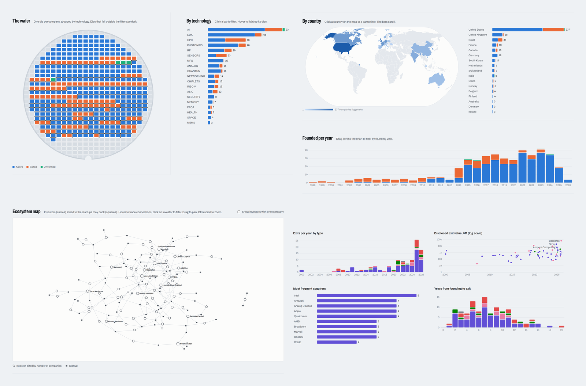

# An Open Database of Awesome Semiconductor Startups

[](https://aolofsson.github.io/awesome-semiconductor-startups/dashboard/)

Search, filter and chart the whole database, including exits, in the
[interactive dashboard](https://aolofsson.github.io/awesome-semiconductor-startups/dashboard/).
It reads the CSV files in this repository, so it always matches the tables below.

## Citation:

If you use this repository in research, articles, presentations, or market analyses, please cite:

> Andreas Olofsson. *Database of Awesome Awesome Semiconductor Startups*.
> GitHub repository.
> https://github.com/aolofsson/awesome-semiconductor-startups

BibTeX:

```bibtex
@misc{olofsson_awesome_semiconductor_startups,
  author = {Andreas Olofsson},
  title = {Database of Awesome Semiconductor Startups},
  year = {2026},
  howpublished = {\url{https://github.com/aolofsson/awesome-semiconductor-startups}}
}
```

## Adding a company:

1. Create a branch
2. Add entry to './startups.csv'
3. Run '$ python ./update.py'
4. Run '$ python ./check.py' and fix any errors it reports
5. Submit a Pull Request

## Submission Guidelines:

* Startup requirements
	* startup (ie not steady state)
	* semi company (ie not application software)
	* product company (ie. not services)
* Alphabetical listing
* Short single sentence description
* No Performance claims in description!
* All entries must be confirmed with public link
* Max 80 char display width
* Categorize the startup based on technology table below
* Use standard two letter country codes
* Do NOT edit the README directly, it's auto-generated

## Disclaimer:

This databse is volunteer work. We do not guarantee correctness.
All information was gathered via public web sites and/or first hand knowledge.

DATA IS PROVIDED "AS IS", WITHOUT WARRANTY OF ANY KIND, EXPRESS OR IMPLIED,
INCLUDING BUT NOT LIMITED TO THE WARRANTIES OF MERCHANTABILITY, FITNESS FOR A
PARTICULAR PURPOSE AND NONINFRINGEMENT. IN NO EVENT SHALL THE AUTHORS OR COPYRIGHT
HOLDERS BE LIABLE FOR ANY CLAIM, DAMAGES OR OTHER LIABILITY, WHETHER IN AN ACTION
OF CONTRACT, TORT OR OTHERWISE, ARISING FROM, OUT OF OR IN CONNECTION WITH THE
SOFTWARE OR THE USE OR OTHER DEALINGS IN THE SOFTWARE.

## Categories
